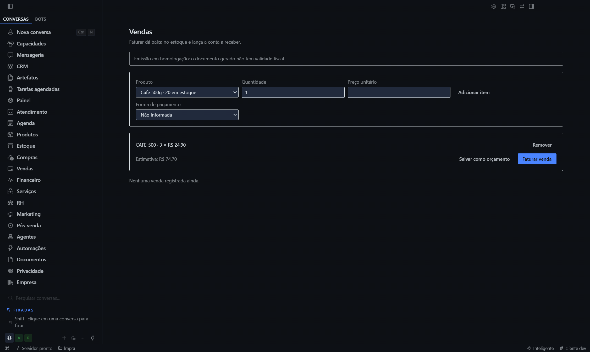

# Fluxo pela TELA — a lacuna do r176 fechada (rodadas 177–178)

## O que a r176 declarou

> *"A camada visual nunca foi exercitada de ponta a ponta."*

**Exercitada.** Este documento registra o fluxo feito **pela interface**, com captura.

## O que foi feito, passo a passo

| Passo | Ação | Resultado |
|---|---|---|
| 1 | produto criado (`CAFE-500`, 20 unidades em estoque) | `{ok: true}` |
| 2 | navegação para `/sales` | `h1: "Vendas"` |
| 3 | select de produto preenchido | opções: `["CAFE-500"]` |
| 4 | quantidade `3`, preço `24,90` | campos encontrados e preenchidos |
| 5 | clique em **"Adicionar item"** | item na lista |
| 6 | clique em **"Faturar venda"** | faturado |

## O efeito, medido depois do clique

```
ESTOQUE.apos         → 17000       (20 − 3 unidades)
FINANCEIRO.aReceber  → 7470        (3 × R$ 24,90)
VENDAS.total         → 1
VENDA.status         → "faturado"
```

**Um clique em "Faturar venda" baixou o estoque de 20 para 17 e lançou R$ 74,70 a receber. Pela interface.**

## O que a tela mostrou



| Elemento | Conteúdo |
|---|---|
| Título | **Vendas** |
| Subtítulo | *"Faturar dá baixa no estoque e lança a conta a receber."* |
| Aviso fiscal | *"Emissão em homologação: o documento gerado não tem validade fiscal."* |
| Produto selecionado | **Cafe 500g · 20 em estoque** |
| Linha do item | **CAFE-500 · 3 × R$ 24,90** |
| Estimativa | **R$ 74,70** |
| Ações | Remover · Salvar como orçamento · **Faturar venda** |

**A tela promete exatamente o que faz.** O subtítulo anuncia o efeito cruzado, e o efeito aconteceu. Não é um
botão que mente.

## O erro do meu instrumento — terceira vez

```
linhasNaTabela => 0
```

A conclusão imediata seria *"o item não foi adicionado"*. A imagem mostra o item **adicionado, com total
calculado**. **A lista não usa `<tbody><tr>`** — usa divs.

Este é o **terceiro** falso negativo meu causado pelo instrumento, não pelo produto:

| R | Instrumento errado | O que eu teria concluído |
|---|---|---|
| 133 | seletor `input[type=date]` pegando o formulário errado | "o campo não atualiza" |
| 165 | rota `/vendas` em vez de `/sales` | "metade do ERP não tem h1" |
| **177** | contador de `<tr>` numa lista de divs | "o item não foi adicionado" |

**Nas três, olhar a imagem resolveu o que a sonda não resolvia.**

## O que a tela NÃO provou

| Item | Estado |
|---|---|
| **Preço unitário digitado manualmente** | **não entrou** — o item usou o preço **do catálogo** (24,90), não o que digitei |
| "Salvar como orçamento" | não exercitado |
| "Remover" | não exercitado |
| Forma de pagamento selecionada | ficou "Não informada" |
| Concorrência (2 vendas do mesmo SKU) | não medido |
| Um humano de verdade | **eu preenchi via CDP**, não com teclado e mouse |

**A última linha importa**: o preenchimento usou o setter nativo do React e disparou eventos. **É o mesmo
caminho que o teclado usa**, mas não é um teclado.

## O que mudou no estado do produto

| Antes | Depois |
|---|---|
| fluxo provado **pelo canal IPC** | fluxo provado **pela tela** |
| "a camada visual nunca foi exercitada" | **exercitada**, com captura e números |
| 2 fluxos vigiados por teste | 2 fluxos + **1 verificado na UI** |

## Medido

| Medida | Valor |
|---|---|
| Passos executados na tela | **6** |
| Capturas | **2** |
| Efeitos verificados após o clique | **4** (estoque, financeiro, vendas, status) |
| Falsos negativos do meu instrumento | **1** (o contador de `<tr>`) |
| Falsos negativos acumulados na sessão | **3** |
| Campos que não funcionaram como eu esperava | **1** (preço manual) |
