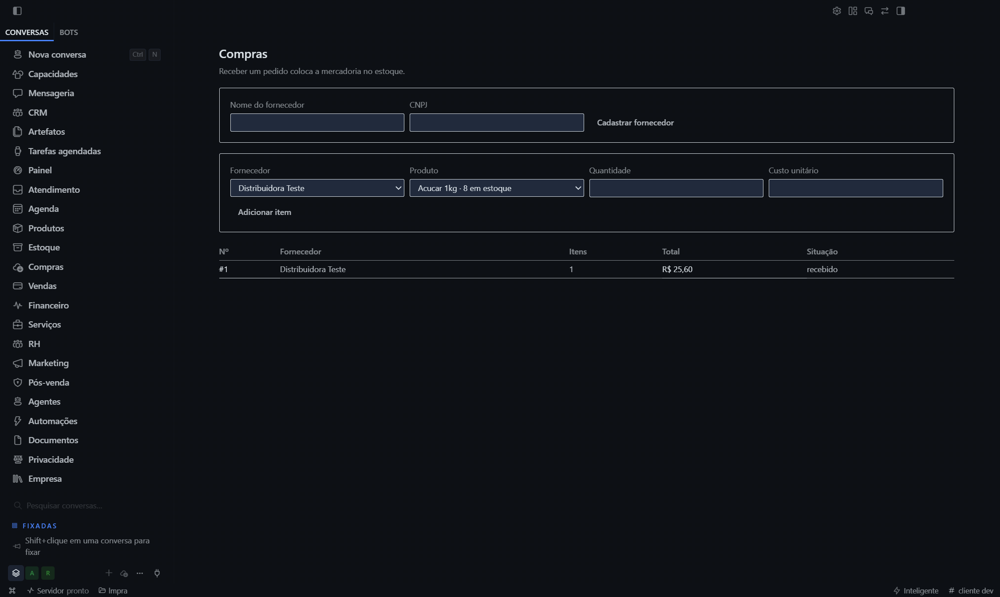

# Compra pela TELA — a simetria visual (rodadas 179–180)

## O que foi feito

O espelho do fluxo de venda da r177, agora na camada visual: **cadastrar fornecedor, montar o pedido, receber** —
tudo pela interface, com captura.

| Passo | Ação | Resultado |
|---|---|---|
| 1 | nome `Distribuidora Teste` + CNPJ, clique **"Cadastrar fornecedor"** | id gerado `sup_…` |
| 2 | select Fornecedor | `["sup_1793832725216_v3bo4m"]` |
| 3 | select Produto | `["ACUCAR-1"]` |
| 4 | quantidade `8`, custo `3,20` | preenchidos |
| 5 | clique **"Adicionar item"** | botões passam a incluir *"Receber pedido"* |
| 6 | clique **"Receber pedido"** | recebido |

## O efeito, medido depois do clique

```
ESTOQUE.apos       → 8000      (8 unidades × 1000 milésimos)
FINANCEIRO.aPagar  → 2560      (8 × R$ 3,20)
PEDIDOS            → 1
PEDIDO.status      → "recebido"
```

## O que a tela mostrou



| Elemento | Conteúdo |
|---|---|
| Título | **Compras** |
| Subtítulo | *"Receber um pedido coloca a mercadoria no estoque."* |
| Fornecedor | **Distribuidora Teste** |
| Produto | **Acucar 1kg · 8 em estoque** |
| Tabela | **#1 · Distribuidora Teste · 1 item · R$ 25,60 · recebido** |

**A tela diz "Receber um pedido coloca a mercadoria no estoque" — e o produto agora mostra "8 em estoque". A
promessa e o efeito estão na mesma imagem.**

## O detalhe que responde à dúvida da r177

Na venda, o **preço digitado manualmente não entrou** (o item usou o preço do catálogo). **Aqui o custo `3,20`
entrou**, e o total fechou em **R$ 25,60 = 8 × 3,20**.

**A diferença prova que o campo de custo da compra aceita digitação e que o cálculo usa o valor digitado.** Não
explica o caso da venda — mas mostra que o caminho existe e funciona em outro formulário.

## A simetria, nas duas camadas

| | Canal IPC | Tela |
|---|---|---|
| **Venda** | ✓ 3 testes | ✓ estoque 20000→17000, recebível 7470 |
| **Compra** | ✓ 4 testes | ✓ estoque 0→8000, a pagar 2560 |

**A venda baixa e lança a receber. A compra sobe e lança a pagar.** As duas, provadas no canal **e** na tela.

## O que continua não provado

| Item | Estado |
|---|---|
| "Salvar pedido" (sem receber) | não exercitado |
| Custo digitado na **venda** | continua sem explicação |
| Concorrência (2 recebimentos do mesmo pedido pela tela) | não medido |
| Um humano de verdade | **eu preenchi via CDP**, não com teclado e mouse |
| Aprovação de compra acima do limite | **não exercitada** — o GOAL pede, a tela não mostrou |

## O placar de prova de uso

| Fluxo | Canal | Tela | Humano |
|---|---|---|---|
| **Venda** | ✓ | ✓ | ✗ |
| **Compra** | ✓ | ✓ | ✗ |
| Agenda, CRM, Financeiro, RH, Marketing, Pós-venda | parcial | ✗ | ✗ |

**Dois fluxos, quatro camadas de prova, zero executados por uma pessoa.**

## Medido

| Medida | Valor |
|---|---|
| Passos na tela | **6** |
| Capturas | **1** (o estado final, com a tabela) |
| Efeitos verificados | **4** (estoque, financeiro, pedidos, status) |
| Falhas de instrumento nesta rodada | **0** |
| Fluxos com prova dupla (canal + tela) | **2** |
