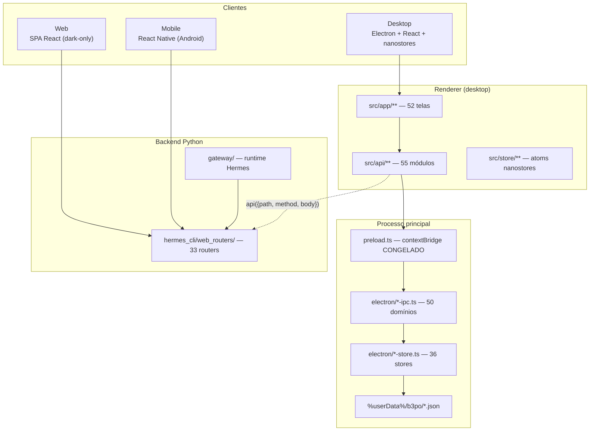

# ARCHITECTURE_CURRENT — como o B-3PO é hoje (medido, não projetado)

> O goal pede diagramas C4/Mermaid, boundaries, dependências e interfaces **versionadas**. Este
> documento descreve o que **existe**, não o alvo. O alvo está em `GAP_ANALYSIS.md`.

## 1. Camadas reais



## 2. As **duas** superfícies IPC (e por que isso importa)

| Superfície | Assinatura | Uso |
|---|---|---|
| **Ponte por domínio** | `window.hermesDesktop.<dominio>.<metodo>` | 50 domínios; tipada em `src/api/*` |
| **Proxy REST** | `window.hermesDesktop.api({ path, method, body })` | alcança os 33 routers do Python |

**Consequência arquitetural**: existem **dois caminhos** para a mesma informação, e eles não
compartilham fonte. Um domínio pode estar respondendo pela ponte e desatualizado no router, ou o
contrário. Isso é a origem do risco **R2**.

**Fato medido no V4**: o objeto exposto por `contextBridge` é **congelado**. Nenhum teste em runtime
consegue substituir um método da ponte — a tentativa foi feita e falhou silenciosamente. Testes de
estado da UI têm de **trocar o módulo de API**, não a ponte.

## 3. Persistência — o ponto mais frágil

**Não há banco de dados.** 36 stores gravam **um JSON por domínio** em
`%userData%/b3po/<dominio>.json`.

```ts
// electron/sales-store.ts:86  — o padrão repetido 36 vezes
export function salesStorePath(userDataDir: string): string {
  return join(userDataDir, 'b3po', 'sales.json')
}
```

**Não há helper compartilhado**: cada store tem o seu `readFileSync` + `JSON.parse` + validação
própria. Não há transação entre domínios — o fluxo *pedido → estoque → financeiro* atravessa três
arquivos JSON sem atomicidade.

## 4. Autorização

| Camada | Mecanismo | Verificação |
|---|---|---|
| IPC | `exigirAtor` por canal | ratchet `permission-coverage-ratchet.test.ts` — **50 canais, dívida 16** |
| Rotas | `permission-guard` no renderer | guarda de UI |
| Modos | **não autoriza** | documentado em `lib/ambiente.ts` desde a r121 |

**O modo de navegação não substitui RBAC** — é invariante declarada e testada.
`nav-rbac` filtra o menu **por cima** do que o seletor de modo escolhe.

## 5. O que existe e não existiria num desenho ideal

| Achado | Evidência |
|---|---|
| `contextBridge` congelado impede teste de falha em runtime | medido na r3 do V4 |
| 36 stores com persistência própria, sem transação | `electron/*-store.ts` |
| `sofia.status()` responde `{ error }` | medido em runtime |
| `listarAgentes`/`listarProjetos` engoliam erro e devolviam `[]` | **corrigido** no V4 r1 |
| `$dirtyPreviewUrls` era registro morto | **corrigido** na r104 do ciclo anterior |
| Ratchet de canais: **16 de 50** ainda sem `exigirAtor` | `permission-coverage-ratchet.test.ts` |

## 6. Compatibilidade upstream

`main` é **espelho de `NousResearch/hermes-agent`** e **nunca recebe commit de produto**. O produto
vive em `b3po-brand` (985 commits à frente). Toda alteração no upstream precisa ser
**retrocruzada** — o ciclo anterior fez isso 14 vezes (`UPSTREAM-PATCH-REGISTER.md`), sendo o maior
o patch do `Select` de fornecedor, hoje aplicado por `postinstall` + `prebuild` + `pretest` +
`pretypecheck`.
